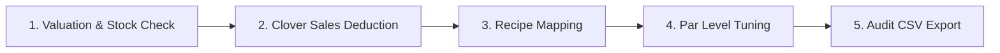

# 🥣 CB Inventory – Smart Inventory & Operations Suite

> **Progressive Web App (PWA)** built for **Chè Bông Dessert & Snacks** to manage raw ingredients, FIFO batch tracking, Clover POS recipe bill-of-materials (BOM), physical cycle-count audits, and waste logging with real-time Supabase PostgreSQL synchronization.

---

## 📱 How to Install as a Native Mobile App (PWA)

CB Inventory is configured as a standalone **Progressive Web App (PWA)**. When installed to your phone's Home Screen, it runs **fullscreen with zero browser address bars or navigation toolbars**, just like an App Store / Play Store application.

### 🍏 On iPhone / iPad (iOS Safari)
1. Open the deployment URL in **Safari** (`https://your-app.vercel.app`).
2. Tap the **Share** icon at the bottom of the screen (`⎋` — square with an arrow pointing up).
3. Scroll down the menu and tap **Add to Home Screen** (`＋`).
4. You will see the **CB Inventory** app title and the dessert bowl icon. Tap **Add** in the top right.
5. Close Safari and open **CB Inventory** from your iPhone Home Screen. It will launch in **fullscreen native mode** with no browser bars!

### 🤖 On Android (Google Chrome)
1. Open the deployment URL in **Chrome**.
2. Tap the **Install** button on the bottom prompt (or tap the **three dots `⋮`** in the top-right corner and select **Install app** or **Add to Home screen**).
3. Tap **Install** to confirm.
4. The app icon will appear in your App Drawer and on your Home Screen.

---

## 🛠️ How It Was Built (Tech Stack & Architecture)

| Layer | Technology | Purpose |
| :--- | :--- | :--- |
| **Framework** | **Next.js 15** (App Router) | Server Components, Server Actions for mutations, zero-client API overhead |
| **UI Library** | **React 19** | Optimized rendering, concurrent transitions, modern hooks |
| **Styling** | **Tailwind CSS v4** | Ultra-fast build times, mobile-first responsive layout, safe-area inset support |
| **Database** | **Supabase (PostgreSQL)** | Persistent storage, real-time trigger for auto stock computation, Row Level Security (RLS) |
| **Client/Server SDK** | `@supabase/ssr` & `@supabase/supabase-js` | Secure cookie-based server queries and browser client access |
| **PWA & Offline** | **Custom Service Worker + Web Manifest** | App shell caching, Stale-While-Revalidate asset delivery, standalone display mode |
| **Deployment** | **Vercel** | Automated CI/CD, Edge network routing, SSL termination |

### Architectural Highlights
- **Automated Stock Balance Trigger:** Inventory is recalculated via a PostgreSQL database trigger (`trg_inventory_transaction`) whenever a transaction (`RESTOCK`, `WASTE`, `SALE`, or `CYCLE_COUNT`) is recorded.
- **FIFO Batch Management:** Batches track expiration dates, initial quantities, and remaining balances, ensuring older stock is alerted before newer inventory.
- **Safe-Area Inset Support:** CSS variables (`env(safe-area-inset-top)` and `env(safe-area-inset-bottom)`) prevent UI clipping against the iPhone Dynamic Island, camera notch, and Home indicator bar.
- **Resilient Fallbacks:** Fallback handlers in Supabase client and server initializers guarantee builds never crash if environment variables are temporarily missing during CI/CD steps.

---

## 📋 Staff Daily Workflow (Kiosk / Phone View)

Designed for fast, touch-friendly operation on staff phones or counter tablets without complex navigation.


### 1. Shift Opening / Pre-Shift Inspection (`/staff/dashboard`)
- Review the **Critical Alert Banner** at the top of the dashboard.
- Check for **Low Stock** warnings and **Expiring Soon** flags (ingredients with batches expiring within 48 hours).
- Identify which prep items must be used first following the **FIFO (First In, First Out)** standard.

### 2. Receiving Stock & Shipments (`/staff/restock`)
- Tap **Restock** on the bottom navigation bar.
- Select the ingredient received from the delivery.
- Input the quantity received.
- *(Optional)* Adjust the expiration date if different from the default shelf-life window.
- Tap **Confirm Restock**. The batch is logged, and the ingredient's total available balance updates instantly.

### 3. Logging Spoilage & Discards (`/staff/waste`)
- If an opened container spoils, drops, or exceeds its expiration window:
- Navigate to the **Waste** form.
- Select the ingredient and batch, enter the quantity discarded, and select a reason code (*Expired*, *Dropped/Damaged*, *Quality Issue*).
- Tap **Log Waste**. The stock balance is deducted immediately, preserving audit accuracy.

### 4. End-of-Shift Physical Cycle Count (`/staff/cycle-count`)
- At the end of each shift or closing:
- Open **Cycle Count**.
- Perform a physical count of key items (milk, jellies, tapioca, purees).
- Enter the real count in the field. The screen highlights discrepancies in green (balanced) or red (variance) against system expectations.
- Submit the audit.

### 5. Groceries & Prep Planning (`/staff/groceries`)
- Open the **Groceries** tab to view auto-generated restock recommendations based on current stock versus daily burn rate.

---

## 👔 Manager Daily Workflow (Control Center)

Designed for store managers, operators, and owners on mobile or desktop to monitor financial valuation, food cost variances, and POS recipe mappings.



### 1. Inventory Health & Financial Valuation (`/manager/dashboard`)
- Review real-time KPIs: **Total Inventory Valuation ($)**, **Active SKUs**, **Low Stock Count**, and **Spoiled Batch Losses**.
- Review recent discrepancies flagged during staff cycle counts to investigate variances early.

### 2. Clover POS Sales Deficit Calculator (`/manager/recipes`)
- Enter the daily sales totals from your Clover POS terminal (e.g., 25 Avocado Smoothies, 40 Chè Ba Màu).
- The built-in **Deficit Engine** multiplies items sold by their respective Bill of Materials (BOM) ingredient quantities.
- Check the live shortfall calculation: it displays exactly how much of each raw ingredient was consumed and highlights if current stock went negative.
- Tap **Commit Sales Usage** to deduct ingredient usage directly into the audit transactions ledger.

### 3. Recipe & Bill of Materials Management (`/manager/recipes`)
- Add new Clover menu products (e.g., Seasonal Specials).
- Map required ingredients to each product (e.g., *1 Durian Chè = 0.15 kg Durian Pulp + 0.10 L Coconut Milk + 0.05 kg Pandan Jelly*).
- System automatically calculates the unit ingredient cost for each dessert.

### 4. Setting Safety Thresholds & Shelf-Life (`/manager/thresholds`)
- Edit par levels, minimum low-stock alerts, shelf-life days, daily usage expectations, and purchase unit costs ($/kg or $/L).
- Changes reflect immediately across staff restock and cycle-count screens.

### 5. Official Audit Ledger & Accounting Export (`/manager/reports`)
- View a chronological log of all stock movements with timestamps and transaction types (`RESTOCK`, `WASTE`, `SALE`, `CYCLE_COUNT`).
- Tap **Export CSV** to download a spreadsheet for monthly food-cost accounting and tax filing.

---

## ⚙️ How to Set It Up to Be an Efficient App for Managers

### Step 1: Provision the Database (Supabase)
1. Create a project at [supabase.com](https://supabase.com).
2. Open the **SQL Editor** in your Supabase dashboard.
3. Open [`supabase/schema.sql`](file:///Users/haonguyen/Downloads/chebong-inventory-management/supabase/schema.sql) from this repository, copy its contents, paste them into the SQL editor, and click **Run**.
4. This script sets up:
   - `ingredients` table with real-time stock balances
   - `inventory_batches` table for FIFO tracking
   - `inventory_transactions` audit log
   - `clover_items` & `recipe_ingredients` for POS recipe mapping
   - `handle_inventory_transaction()` PostgreSQL trigger for automatic stock balance calculations
   - Row Level Security (RLS) policies

### Step 2: Configure Environment Variables
In your local environment ([`.env.local`](file:///Users/haonguyen/Downloads/chebong-inventory-management/.env.local)) or on your **Vercel Project Settings > Environment Variables**, add:

```env
NEXT_PUBLIC_SUPABASE_URL=https://your-project-id.supabase.co
NEXT_PUBLIC_SUPABASE_ANON_KEY=your-anon-key-here
```

### Step 3: Five Manager Best Practices for Maximum Efficiency
1. **Set Accurate Unit Costs:** Enter precise cost-per-unit figures in the **Thresholds** page so your **Total Valuation ($)** and waste financial metrics reflect accurate bookkeeping numbers.
2. **Realistic Par Levels (Low Stock Thresholds):** Set the threshold to represent **2 days of sales volume** (`2 * daily_usage_rate`). This prevents emergency grocery store runs while avoiding over-ordering perishable jellies.
3. **Map Recipes Once, Deduct Daily:** Take 15 minutes to map every regular menu item to its raw ingredients under **Manager > Recipes**. At closing, simply type the total quantities sold from your Clover end-of-day report and tap **Commit Sales Usage**.
4. **Mandate Short End-of-Day Cycle Counts:** Have closing staff audit just **3–5 high-value ingredients** each night (durian pulp, condensed milk, jelly). Rotating short counts catches spillage or theft faster than a monthly count.
5. **Bookmark as PWA on Manager's Phone:** Use Safari's **Add to Home Screen** on your phone so you can check store inventory levels and approve supply runs in seconds from anywhere.

---

## 💻 Local Development

```bash
# 1. Install dependencies
npm install

# 2. Run local development server
npm run dev

# 3. Build for production (verifies TypeScript, ESLint, and PWA manifest)
npm run build
```

Open [http://localhost:3000](http://localhost:3000) in your browser.

---

## 📄 License
Private & Proprietary — Developed for **Chè Bông Dessert & Snacks**. © Nguyen Hao Bui 2026.
